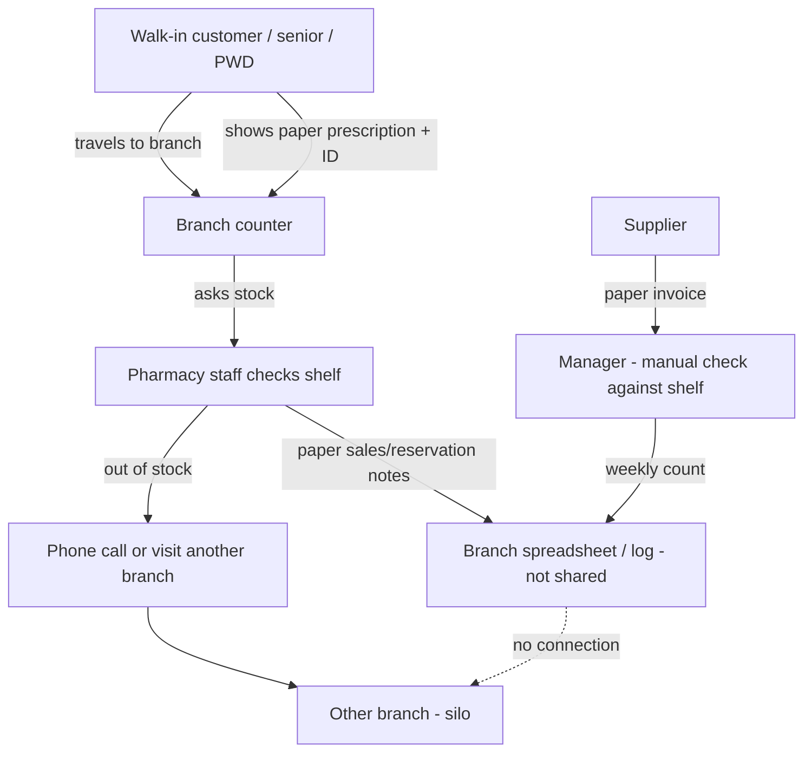
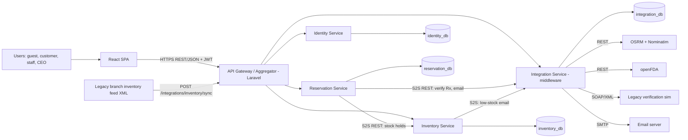
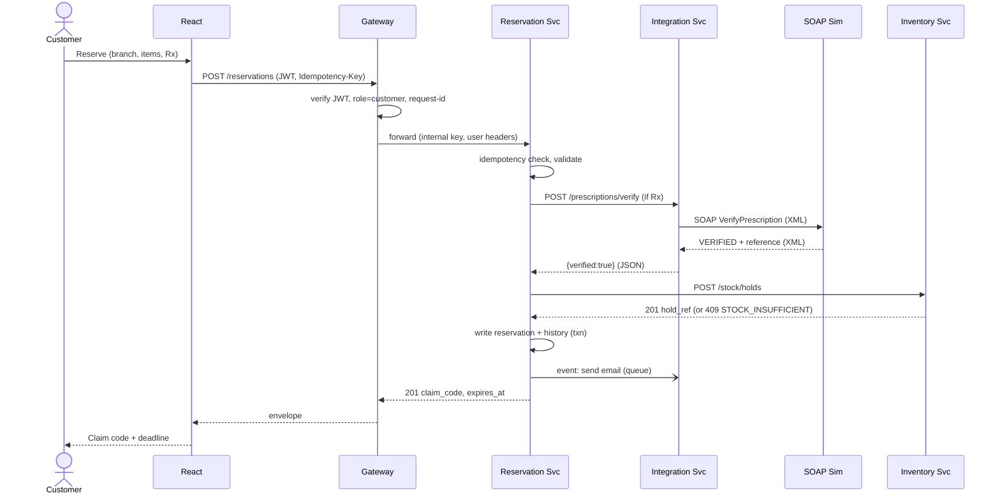
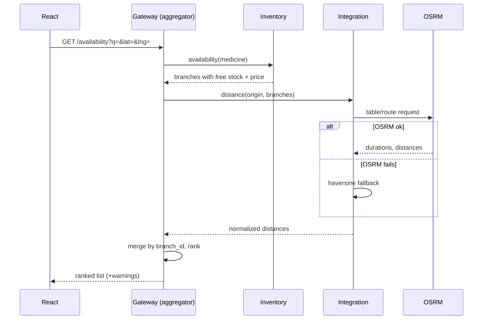
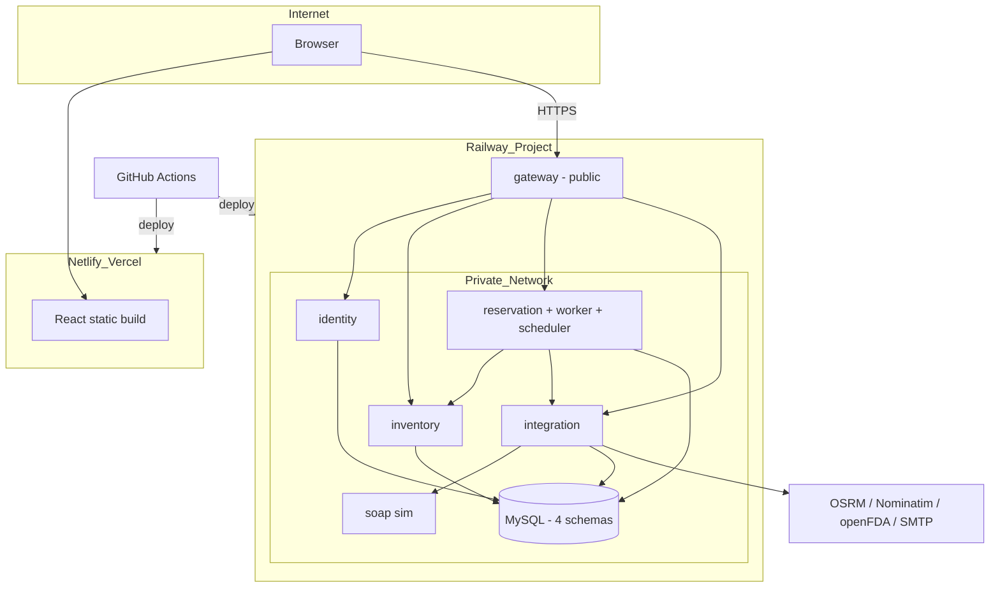

# PharmAssist (SIA Version) - Project Plan

Course: Systems Integration and Architecture 1 (CIT 305 - IT31S1)
Stack: React (client) + Laravel (gateway and services) + MySQL
Status: PLAN ONLY. No code has been written for the SIA version yet.
Sources reviewed: `[SIA 1] Final Project Deliverables and Requirements`, `[SIA 1] Final Project Documentation Template`, `FINAL PROJECT (DRAFT)` (our midterm proposal), `G1 PharmAssist` (professor feedback, 83/100), `UI SCREENSHOT`, `AER_PROGRESS UPDATE`, `ABLOLA_CATINDIG_REYES-IMRAD`, and the old code in `PharmAssist.zip` (extracted to `old/`, uploads excluded).

---

## 0. Read this first: critical findings

| # | Finding | Why it matters | Decision in this plan |
|---|---------|----------------|-----------------------|
| 1 | **Submission is Oct 26, 2026 and the presentation is Oct 28, 2026** (SIA requirements, section 11). Today is Oct 23. | About 3 working days for 17 minimum requirements, a cloud deployment, tests and a full paper. | Scope is tiered (section 19). Tier 0 is the demo-critical path and is built first. Everything else is cut before Tier 0 slips. |
| 2 | The SIA rules require **at least 3 backend services, an API gateway, 2 service-to-service integrations, XML, SOAP/legacy (or an approved alternative), JMeter-or-equivalent, CI/CD, and cloud deployment**. "One Laravel app" does not satisfy this. The requirements also say CRUD alone is not enough. | A single Laravel monolith fails requirement 2, 3, 4 and 17. | Laravel is used for **every** service plus the gateway (monorepo, separate deployables). This keeps the "Laravel backend" decision and satisfies SIA. |
| 3 | The professor flagged that the midterm diagram showed 6 databases while the text said one shared MySQL DB. | Shared DB breaks loose coupling. | **Option A**: each service owns its own logical schema and never joins across schemas. Services talk only through REST. Limitation: one MySQL server hosts all schemas (section 21). |
| 4 | The midterm draft said "convert PHP to Python microservices" and "Railway + GCP" in one place and "Hostinger" in another. | Professor flagged both stack drift and hosting conflict. | Stack frozen: **Laravel (PHP) + React + MySQL**. Hosting: **Railway for backend + DB, Netlify or Vercel for React**. Hostinger is dropped. Python (Flask OCR in `app.py`) is not carried over. |
| 5 | The old repo (`PharmAssist.zip`) contains **real ID photos (`uploads/id_photos/`), 250 KB of error logs, an 83 MB OCR model, and a Google service-account JSON filename hardcoded in `app.py`**. `scanner_api.php` uses `Access-Control-Allow-Origin: *`. | The SIA rules forbid committed secrets. The ID photos are personal data. | Do **not** copy `uploads/`, `*.log`, `ocr_models/`, or any credential file into the new repo. Rotate the Google credential if it was ever pushed anywhere. |
| 6 | The working folder is **not a Git repository**. | Git with visible per-member commits is graded (requirement 15, plus the contribution evidence). | `git init` is the first action of Step 1. Each member commits to their own feature branch. |
| 7 | The Documentation Template says "Course: Object-Oriented Programming". | It is a template error. | Replace with SIA 1 / CIT 305 - IT31S1 in our copy. |
| 8 | TTS and STT must be removed (your instruction). The old UI also had gesture recognition (Teachable Machine) and image-to-text. | They are not integration features and the professor told us to prune high-risk features. | TTS, STT and gesture recognition are removed. Image-to-text (OCR) becomes **Tier 2 optional**. Accessibility is kept through zoom, contrast, plain-language guidance and keyboard/ARIA support (section 1). |

---

## 1. Project Overview

**What PharmAssist is.** A web-based e-pharmacy and reservation platform for a multi-branch pharmacy chain in the Philippines. Customers search a medicine, see which branches have stock, ranked by how far they are, and reserve it online with a claim code. Pharmacy staff manage inventory and reservations per branch. The CEO oversees all branches and approves new accounts.

**Purpose.** SDG 3, Target 3.8 (access to safe, effective, affordable essential medicines). It addresses stock-outs, 45-90 minute queues, siloed branch inventory and unsafe rogue online sellers (from our proposal and the old AER/IMRAD).

**Intended users.** Customers (including senior citizens and PWDs), Pharmacy Technician, Pharmacy Assistant, Branch Manager, CEO/Administrator, plus guests (browse only). Stakeholders who are not application roles: the Systems Integrator, the development team and the System Administrator (they appear in the stakeholder table of the paper).

**How the previous project is adapted.** The old system was a PHP monolith (PHP pages, one MySQL DB, PHP sessions). The SIA version is an **integrated system**: React SPA -> API Gateway -> four Laravel services with separate schemas -> external REST APIs, a SOAP/XML legacy-style service, and SMTP. The business idea is kept; the architecture is rebuilt.

**Accessibility and inclusivity (kept from the IMRAD, minus TTS/STT).**
- Page zoom controls (A+/A-): 100% of IMRAD respondents wanted this.
- High-contrast and readable-font toggles, large touch targets, keyboard navigation, ARIA labels, visible focus.
- Plain-language medicine guidance and step-by-step guide pages (100% of respondents wanted simple explanations; 90% found medical terms confusing). This is served by the Counseling endpoint.
- Simple, few-step reservation flow (70% strongly preferred simple apps).
- Mobile-first layout (100% of respondents used phones).

---

## 2. Previous System vs. SIA Version

| Area | Previous PharmAssist | Retained | Improved | Newly integrated for SIA |
|------|---------------------|----------|----------|--------------------------|
| Architecture | PHP monolith, server-rendered pages, PHP sessions | Business flows and role concept | Split into gateway + services | API Gateway, 4 services, S2S REST, middleware |
| Frontend | PHP/HTML/CSS pages (`homepage.php`, `medicines.php`, `cart.php`, ...) | Page structure, branding, CSS and images in `plugins/`, `img/` | Rebuilt as React SPA, responsive, accessible | Consumes only the gateway API |
| Auth | PHP session, `role` enum with branch baked in (`manager1`, `manager2`, ...) | Email verification, ID verification, password reset | JWT, `role` + `branch_id` separated, RBAC enforced at gateway **and** service | AuthN/AuthZ across components, internal service key |
| Database | One DB, 15 tables, medicine duplicated per branch (`medicine.branch`), reservation = one row per item | Core entities | Database-per-service, `medicines` catalog separated from `branch_inventory`, reservation header/items split, status history, audit | Idempotency keys, stock holds, integration logs |
| Inventory | Manual edit, `stock_alerts` | Low-stock alerts, thresholds | Stock holds, concurrency-safe decrement | XML/JSON inventory sync from a "legacy branch system" |
| Reservation | `submit_reservation.php`, shared `RES-YYYY-xxxx` code, no expiry enforcement | Claim code idea, Pending/Approved/Rejected | Full status lifecycle, 48 h auto-expiry that releases stock | Orchestrates Inventory + Integration services |
| Prescription | Upload image, staff review | Staff review | Rx-required check | SOAP/XML verification call to legacy-style service |
| Location | Branch address text | Branch list | Coordinates per branch | External distance API + mashup ranking |
| Medicine info | Static guide pages | Guide content | Counseling endpoint | openFDA external API |
| Notifications | PHPMailer + `notifications` table | Email + in-app | Event-driven (publish/subscribe + queue) | SMTP adapter, delivery log |
| Multimodal | TTS, STT, image-to-text, gesture, zoom | Zoom, image-to-text (optional) | -- | **TTS, STT, gesture removed** |
| Staff shifts | `shifts`, `staff_shifts` | -- | -- | **Out of scope** (no integration value, not in the professor's TO-BE figure) |
| Testing | Manual | -- | -- | Postman/Newman, PHPUnit, JMeter, failure simulation |
| DevOps | Dockerfile (Apache), manual deploy | Docker | Monorepo, docker-compose | GitHub Actions CI/CD, Railway |

**SIA focus:** service boundaries, gateway/middleware role, REST+JSON, XML/SOAP, external API, mashup, security, tests, deployment, CI/CD.

### Professor feedback checklist (G1 PharmAssist, 83/100) and where it is addressed

| Feedback | Resolution | Section |
|----------|-----------|---------|
| Define technical operational metrics (throughput, error SLAs) | SLO table | 4 |
| Missing visual AS-IS diagram of paper flow | AS-IS flowchart | 17 |
| 6 DB diagram vs 1 shared DB conflict | Option A, schema per service | 10 |
| `POST /verifications` row incomplete; SOAP lacks WSDL/format | Fully specified endpoints + WSDL operation + XML samples | 8, 9 |
| Inconsistent endpoint naming | Lowercase plural nouns, `/api/v1` | 9 |
| Unified response envelope | `{status, service, data, error}` (+ `request_id`) | 9 |
| Railway vs Hostinger | Railway | 16 |
| Scope too heavy / stack drift | Tiers, Laravel only | 19 |
| Core loop: Client -> Gateway -> Reservation -> Inventory -> Maps API | Implemented as the primary demo flow | 11 |
| GitHub Actions running lint + Postman tests before merge to `main` | CI workflow | 16 |

---

## 3. Functional Requirements

**Guest**
- FR-G1 Browse medicines and branch availability (read only). Cannot reserve.

**Customer**
- FR-C1 Register with email verification and ID upload; log in; reset password.
- FR-C2 Search medicines (generic or brand, fuzzy), filter by category and Rx requirement.
- FR-C3 See per-branch availability and price, **ranked by travel time/distance** from their location.
- FR-C4 View plain-language counseling/usage info for a medicine.
- FR-C5 Reserve one or more medicines at one branch; upload prescription if Rx required; receive claim code and expiry time.
- FR-C6 View, track and cancel own reservations; see notifications.
- FR-C7 Accessibility controls (zoom, contrast).

**Pharmacy Technician** (UI baseline: Medicine Inventory, Reservation Requests)
- FR-T1 View/update branch stock, price, threshold, batch, expiry.
- FR-T2 View incoming reservation requests for own branch; approve or reject; view uploaded prescription.

**Pharmacy Assistant** (UI baseline: Dashboard, Medicine Inventory, Reservation Status, Summary Reports)
- FR-A1 View branch dashboard, inventory (read), reservation status.
- FR-A2 Mark an approved reservation as completed after verifying the claim code.
- FR-A3 View branch summary report.

**Branch Manager** (UI baseline: Dashboard, Staff Management, Medicine Inventory, Reservation Requests, Reservation Status, Messages, Summary Reports)
- FR-M1 Everything above for the own branch.
- FR-M2 Create and deactivate staff accounts for the own branch.
- FR-M3 Stock-alert view (Messages to CEO is Tier 2).

**CEO / Administrator** (UI baseline: Dashboard, Manage Branches, ID Verification, Notifications, Messages)
- FR-E1 Approve or reject new customer accounts after ID review.
- FR-E2 Create, edit and deactivate branches (including coordinates).
- FR-E3 System-wide dashboard and report across all branches, system health view.

**System (integration functions)**
- FR-S1 Gateway authenticates, authorizes, routes and logs every request.
- FR-S2 Reservation reserves stock atomically through the Inventory Service (hold), and releases it on cancel, reject or expiry.
- FR-S3 Prescription-required reservations are checked through the SOAP verification service; if it is down the request degrades to manual review.
- FR-S4 Availability search combines internal stock with external distance data (mashup).
- FR-S5 Counseling combines internal catalog data with openFDA label data.
- FR-S6 Inventory sync accepts a legacy branch feed in XML or JSON.
- FR-S7 Status changes publish events that create in-app and email notifications.
- FR-S8 Scheduled job expires unclaimed reservations after 48 h and returns stock.
- FR-S9 Health endpoints, centralized request logging with correlation IDs.

---

## 4. Non-Functional Requirements

| Category | Requirement | Measurable target (SLO) |
|----------|-------------|-------------------------|
| Security | JWT auth, RBAC, hashed passwords, validation, private file storage, HTTPS, secrets in env | 0 secrets in repo; 100% of non-public routes return 401/403 for bad tokens/roles |
| Performance | Fast search and reservation under moderate load | `GET /availability` P95 < 800 ms (cached external data, 50 users); `POST /reservations` P95 < 1.5 s (50 users) |
| Throughput | Sustained load on demo tier | >= 30 req/s on search, >= 10 req/s on reservations (to be measured, not promised) |
| Reliability | Graceful degradation when an external dependency fails | Distance API down -> search still works (straight-line fallback), HTTP 200 with `warnings`; SOAP down -> reservation `pending` + `verification: unavailable` |
| Error budget | Low failure rate under load | Error rate < 1% at 50 concurrent users, excluding injected failures |
| Availability | Best effort on free/low tier | Target 99% during demo window; honest note that cold starts exist |
| Timeouts/retries | Bounded waiting | Internal call timeout 3 s, external 5 s, 2 retries with backoff on idempotent GETs only |
| Usability / accessibility | Simple flow, readable, mobile-first | Reservation in <= 4 screens; zoom + contrast controls on every page |
| Scalability | Stateless services | Services can scale horizontally; DB per service; queue workers separable |
| Maintainability | Separation of responsibilities | Service layer pattern, OpenAPI contract, README per service, lint in CI |
| Interoperability | Standard protocols | REST/JSON, SOAP/XML (WSDL), SMTP, REST to third parties |
| Traceability | End-to-end tracing | `X-Request-Id` generated at gateway, propagated and logged by every service |
| Privacy | Handle PII per Data Privacy Act of 2012 (RA 10173) principles | ID images deleted after approval; prescriptions visible only to owner and branch staff |

---

## 5. User Roles

Roles are taken from the old `users.role` enum and the UI screenshot. **No new roles were added.** Branch is now a separate `branch_id` instead of being part of the role name (`manager1`, `manager2`, ...).

| Role | Scope | Can access | Can do | Data view / modify |
|------|-------|-----------|--------|--------------------|
| `guest` (no login) | Public | Landing, medicine search, branch list, availability | Browse only | Read public catalog/availability |
| `customer` | Self | + reservations, notifications, profile | Reserve, cancel own, upload Rx | Own profile, own reservations, own notifications |
| `pharmacy_technician` | Own branch | Inventory, Reservation Requests | Update stock, approve/reject reservation | Branch inventory (R/W), branch reservations (R + status) |
| `pharmacy_assistant` | Own branch | Dashboard, Inventory (read), Reservation Status, Reports | Mark reservation completed by claim code | Branch inventory (R), branch reservations (R + complete), branch report |
| `branch_manager` | Own branch | All staff pages + Staff Management | All technician/assistant actions, manage branch staff | Branch inventory/reservations/staff/reports |
| `ceo` | All branches | CEO pages | Approve/reject accounts, manage branches, view all reports | All branches (R), branch records (W), verification queue |

**Permission matrix (enforced at gateway route middleware AND re-checked in the service)**

| Action | Guest | Customer | Technician | Assistant | Manager | CEO |
|--------|:----:|:-------:|:---------:|:--------:|:------:|:---:|
| Search/availability | Y | Y | Y | Y | Y | Y |
| Create reservation | - | Y | - | - | - | - |
| Cancel own reservation | - | Y | - | - | - | - |
| Approve/reject reservation | - | - | Y | - | Y | - |
| Complete (claim) reservation | - | - | Y | Y | Y | - |
| Update inventory | - | - | Y | - | Y | - |
| View inventory | Y(public view) | Y(public view) | Y | Y | Y | Y |
| Branch report | - | - | - | Y | Y | Y |
| Manage staff | - | - | - | - | Y | Y |
| Approve accounts (ID verification) | - | - | - | - | - | Y |
| Manage branches | - | - | - | - | - | Y |

**Ambiguities to confirm (documented, not assumed silently):**
1. The UI screenshot shows a "Pharmacist" heading above the staff list. It reads as a group heading, not a separate role, and the old DB has no `pharmacist` role. Plan: **no separate Pharmacist role**.
2. The proposal says the Assistant verifies prescriptions at claim and the Technician manages stock; the UI screenshot gives Technician "Reservation Requests" and Assistant "Reservation Status". The matrix above follows the UI screenshot and lets Technician/Manager approve, and Assistant complete. Confirm with the group.
3. The AER says the Senior/PWD **discount and discount-ID upload were removed**, yet the proposal keeps ID verification at registration. Plan: keep account ID verification at registration (CEO approves, ID file deleted after decision); no discounts.

---

## 6. Modules

### 6.1 Module list

| # | Module | Service that owns it | Tier |
|---|--------|----------------------|------|
| M1 | Authentication and Access | identity-service | 0 |
| M2 | Account Verification (ID + email) | identity-service | 0 (email), 1 (ID review) |
| M3 | Catalog and Branches | inventory-service | 0 |
| M4 | Inventory and Stock Alerts | inventory-service | 0 |
| M5 | Availability Mashup (search + distance) | gateway (aggregator) + integration-service | 0 |
| M6 | Reservation Management | reservation-service | 0 |
| M7 | Prescription Verification (SOAP) | integration-service + legacy sim | 0 |
| M8 | Counseling / Medicine Info | gateway + inventory + integration (openFDA) | 1 |
| M9 | Notification | reservation-service (in-app) + integration-service (SMTP) | 1 |
| M10 | Reporting | gateway aggregates from services | 1 |
| M11 | Inventory Sync (XML/JSON) | inventory-service + integration-service (translator) | 1 |
| M12 | Messaging (customer/manager/CEO) | reservation-service | 2 |
| M13 | Medicine scan (OCR) | integration-service | 2 |
| M14 | Accessibility UI | React | 0 |

### 6.2 Per-module detail

| Module | Purpose | Users | Frontend pages | Laravel functions | Tables | APIs | Talks to |
|--------|---------|-------|----------------|-------------------|--------|------|----------|
| M1 Auth | Prove identity, issue JWT, enforce roles | all | Login, Register, Forgot/Reset | `AuthService::login/register/refresh`, `JwtIssuer`, `RoleMiddleware` | `users`, `password_resets` | `/auth/*` | Gateway (token verify), Integration (email) |
| M2 Verification | Verify email and ID | customer, CEO | Verify email, ID upload, CEO ID Verification | `VerificationService`, private file store | `email_verification_codes`, `id_verification_log`, `users.verification_status` | `/auth/verify-email`, `/users/{id}/verification` | Integration (SMTP) |
| M3 Catalog/Branches | Medicine and branch master data | all, CEO (branches) | Medicine list, Medicine detail, Branch list, Manage Branches | `CatalogService`, `BranchService` | `medicines`, `branches` | `/medicines`, `/branches` | Gateway |
| M4 Inventory | Branch stock, alerts, holds | technician, assistant, manager | Inventory page, Stock alerts | `InventoryService::adjust/hold/commit/release`, `LowStockDetector` | `branch_inventory`, `stock_holds`, `stock_movements`, `stock_alerts` | `/branches/{id}/inventory`, `/internal/v1/stock/holds` | Reservation (callee), Integration (alert email) |
| M5 Availability | Rank branches with stock by distance | guest, customer | Search, Map (Leaflet) | `AvailabilityAggregator` (gateway) | none (reads) | `/availability` | Inventory, Integration (distance) |
| M6 Reservation | Reserve, track, expire | customer, staff | Cart/Reserve, My Reservations, Reservation Requests/Status | `ReservationService::create/approve/reject/cancel/complete/expire`, `ClaimCodeGenerator`, `ExpireReservationsJob` | `reservations`, `reservation_items`, `reservation_status_history`, `idempotency_keys` | `/reservations*` | Inventory (holds), Integration (verify, email) |
| M7 Rx Verification | Validate prescription with legacy-style service | system | (inside Reserve flow) | `PrescriptionVerifier` (SOAP client), `XmlTranslator` | `integration_logs` | `/internal/v1/prescriptions/verify` -> SOAP | Legacy SOAP sim |
| M8 Counseling | Plain-language usage info | customer | Medicine detail, Guide | `CounselingAggregator`, `OpenFdaAdapter` | `api_cache` | `/medicines/{id}/counseling` | Inventory (catalog), openFDA |
| M9 Notification | In-app + email | all | Notification page/bell | `NotificationListener`, `MailAdapter` | `notifications`, `integration_logs` | `/notifications*`, `/internal/v1/notifications/email` | SMTP |
| M10 Reporting | Branch and system summaries | assistant, manager, CEO | Summary Reports, Dashboard | `ReportAggregator` | none (reads) | `/reports/*` | Inventory, Reservation |
| M11 Inventory Sync | Import branch stock from legacy feed | system/manager | (Tier 1 admin upload) | `SyncController`, `InventoryFeedTranslator` | `stock_movements` | `/integrations/inventory/sync` | Integration (translator) |
| M14 Accessibility | Zoom, contrast, large targets | all | global toolbar | `AccessibilityContext` (React) | localStorage | -- | -- |

---

## 7. System Architecture

### 7.1 Decision

**Hybrid SOA with an API gateway**, as proposed in the midterm. Gateway = Laravel "edge" app acting as API Gateway and Aggregator. Four Laravel services each own a database schema. One tiny non-Laravel PHP SOAP server simulates the legacy verification system.

**Why this and not alternatives**
- One Laravel app would fail SIA requirements 2, 3, 4 and 17 and repeat the "CRUD monolith" the rules warn against.
- Python or Node services would repeat the stack drift the professor warned about.
- Laravel everywhere means one language, one team skill set, shared conventions.

### 7.2 Component inventory (feeds template section 3.4)

| Component | Responsibility | Tech | Port (local) | Depends on |
|-----------|----------------|------|--------------|------------|
| `client` (React SPA) | UI, accessibility, calls gateway only | React + Vite + React Router + Axios + Leaflet | 5173 | gateway |
| `gateway` | Single entry, JWT verification, RBAC, routing, aggregation, rate limit, CORS, response envelope, request-id, logging | Laravel 11 | 8000 | all services |
| `identity-service` | Users, roles, JWT issuing, email/ID verification | Laravel 11 + `identity_db` | 8001 | integration (email) |
| `inventory-service` | Medicines, branches, branch stock, holds, alerts, feed sync | Laravel 11 + `inventory_db` | 8002 | integration (alert email) |
| `reservation-service` | Reservations, claim codes, expiry, notifications, status history | Laravel 11 + `reservation_db` | 8003 | inventory, integration |
| `integration-service` (middleware) | Adapters/translators for distance API, openFDA, SOAP, SMTP; cache, retry, circuit breaker, integration log | Laravel 11 + `integration_db` | 8004 | external APIs, SOAP sim |
| `legacy-verification-sim` | SOAP/XML prescription verification (WSDL), simulates a legacy/insurance/pharmacy-board system | PHP `SoapServer` | 8005 | none |
| MySQL | One server, **separate schema + separate DB user per service** | MySQL 8 | 3306 | -- |

All five Laravel apps share a lightweight internal convention (response envelope, request-id middleware, `InternalKeyMiddleware`) via a small Composer path package in `packages/pharmassist-common`. This is a library, not a shared database.

### 7.3 Trust boundaries
- Public internet reaches only: React host and the gateway domain.
- Internal services and the SOAP sim are reachable only on the private network (Railway private networking / docker network) and require `X-Internal-Key`.
- External APIs are only called by the integration-service.

### 7.4 Data movement (summary)
`User -> React -> HTTPS+JWT -> Gateway (authN, authZ, request-id) -> Service (business logic, service layer) -> own DB and/or Integration-service -> external API / SOAP / SMTP -> normalized DTO -> service -> gateway envelope -> React -> User.`

The diagram is in section 17.

---

## 8. Integration Architecture

Each row maps to template section 5.2 (service-to-service) and 4.x (external).

| ID | Source -> Destination | Method / endpoint | Request | Response | Validation | Transformation / routing | Errors | Failure handling | Security |
|----|----------------------|-------------------|---------|----------|-----------|--------------------------|--------|------------------|----------|
| I-1 | React -> Gateway | HTTPS REST/JSON `/api/v1/*` | JSON + `Authorization: Bearer` | Envelope | Gateway validates token and route role | Route to service by path prefix | 401, 403, 404, 429 | Axios interceptor shows friendly message; token refresh/redirect to login | CORS allow-list, HTTPS, rate limit |
| I-2 | Gateway -> Identity | `POST /internal/v1/auth/login` etc. | email, password | user + JWT | Identity validates credentials | Gateway wraps in envelope | 401, 422, 423 (locked) | Generic message (no user enumeration) | Internal key; throttle login |
| I-3 | Gateway -> Inventory **and** Integration (Aggregator) | `GET /availability` fans out to `GET /internal/v1/inventory/availability` and `POST /internal/v1/distance` | `medicine` (name/id), `lat`, `lng` | ranked list of branches with `stock`, `price`, `distance_km`, `travel_min` | Gateway validates query; Inventory validates medicine | **Mashup**: join by `branch_id`, normalize units, sort by `travel_min` then `price` | 404 no stock, 422, 503 distance down | Distance down -> fallback to haversine straight-line estimate, `warnings:["DISTANCE_FALLBACK"]`, HTTP 200 | Internal key |
| I-4 | Reservation -> Inventory | `POST /internal/v1/stock/holds` | `reservation_ref`, `branch_id`, `items[{medicine_id, qty}]`, `ttl` | `hold_ref`, per-item result | Qty > 0, branch exists, Rx flag | Inventory locks rows (`FOR UPDATE`) and increments `reserved_quantity` | 404 branch/medicine, 409 `STOCK_INSUFFICIENT`, 409 duplicate `reservation_ref` (idempotent replay returns original) | Timeout -> 504; no hold assumed; reservation not created | Internal key |
| I-5 | Reservation -> Inventory | `POST /internal/v1/stock/holds/{ref}/{commit|release}` | none | updated hold | Hold must be in `held` state | commit decrements stock; release restores | 404, 409 wrong state | **Compensation**: retry release up to 3x; flagged in `integration_logs` for manual fix | Internal key |
| I-6 | Reservation -> Integration -> Legacy SOAP | `POST /internal/v1/prescriptions/verify` then SOAP `VerifyPrescription` | prescription_no, patient, generic name, doctor license (from form) | `{verified, status, reference}` | Required fields, formats | **Message Translator**: JSON -> SOAP XML -> JSON. **Content-based routing**: only items with `prescription_required=true` are sent | SOAP Fault, timeout, malformed XML | Verification `unavailable` -> reservation stays `pending` with `verification_status=manual_review`; staff reviews the uploaded image | Internal key; SOAP API key in env |
| I-7 | Integration -> Distance provider (external REST) | OSRM `route/v1/driving` or `table`; Nominatim geocoding for branch coordinates (one-time, cached) | coordinates | duration (s), distance (m) | Coordinates in PH bounding box | **Adapter** interface `DistanceProvider` (`OsrmProvider`, `HaversineProvider`, optional `GoogleProvider`) | 429, 5xx, timeout | Retry 2x, cache 10 min, circuit breaker, haversine fallback | No key (OSRM/Nominatim); proper `User-Agent`; Google key in env if used |
| I-8 | Integration -> openFDA (external REST) | `GET /drug/label.json?search=openfda.generic_name:"..."` | generic name | indications, dosage, warnings | Non-empty generic name | **Message Translator**: openFDA label -> `{purpose, how_to_use, warnings, source}` plain-language DTO, truncated | 404 no result, 429, 5xx | Fall back to internal `medicines.counseling_summary` and `source:"internal"` | Optional API key in env |
| I-9 | Reservation -> Integration -> SMTP | `POST /internal/v1/notifications/email` via queue | to, template, data | `{queued}` | Email format, template exists | Template rendering; **Pub/Sub**: `ReservationStatusChanged` event | SMTP failure | Queue retry (3 tries, backoff), failed job table, in-app notification still created | SMTP creds in env |
| I-10 | Legacy branch feed -> Gateway -> Inventory | `POST /integrations/inventory/sync` (XML or JSON) | XML `<inventoryFeed>` or JSON | `{accepted, rejected, errors[]}` | XSD-style validation (required nodes), numeric checks | **Message Translator**: XML -> internal JSON via integration-service | 400 malformed XML, 422 bad rows, 415 content type | Partial acceptance with per-row error list; whole feed rolled back if `strict=true` | Manager/CEO role or service key |
| I-11 | Gateway -> all services | `GET /health` | -- | status + dependency checks | -- | Aggregated health JSON | 503 per dependency | Reported per component | Public (no data) |

**Where "mediation, routing, transformation, orchestration" evidence comes from (requirement 17):** gateway (routing, auth mediation), aggregator (orchestration), integration-service (transformation, adapters), reservation-service (orchestration with compensation).

---

## 9. API Design

### 9.1 Conventions
- Base: `https://<gateway>/api/v1`. Lowercase plural nouns, kebab-case multiword.
- JSON, UTF-8. Dates ISO-8601 UTC. Money as decimal string.
- **Response envelope (from professor's feedback + request id):**

```json
{ "status": 200, "service": "inventory-service", "request_id": "b6e1...", "data": { }, "error": null, "warnings": [] }
```
Error form:
```json
{ "status": 409, "service": "inventory-service", "request_id": "b6e1...", "data": null,
  "error": { "code": "STOCK_INSUFFICIENT", "message": "Only 2 left at this branch.", "details": { "available": 2 } } }
```
- Pagination: `?page=1&per_page=20` with `meta` in `data`.
- Mutating reservation calls require `Idempotency-Key` header.
- Auth column: `P` = public, `A` = any authenticated, otherwise role list. Roles: C customer, T technician, S assistant, M manager, E CEO.

### 9.2 Public / gateway endpoints

| Method | Route | Purpose | Auth | Input | Success | Validation | Errors |
|--------|-------|---------|------|-------|---------|-----------|--------|
| POST | `/auth/register` | Create customer account | P | email, password, first_name, last_name, contact_no, id_photo (file) | 201 user (status `pending`) | email unique+valid; password min 8, mixed; file jpg/png <= 2 MB | 422, 409 email exists |
| POST | `/auth/verify-email` | Confirm email code | P | email, code | 200 | 6-digit, not expired/used | 422, 410 expired |
| POST | `/auth/login` | Issue JWT | P | email, password | 200 `{access_token, expires_in, user}` | required fields | 401 invalid, 403 not verified/approved, 429 throttled |
| POST | `/auth/logout` | Invalidate token | A | -- | 204 | -- | 401 |
| GET | `/auth/me` | Current user | A | -- | 200 user | -- | 401 |
| POST | `/auth/forgot-password` | Send reset link | P | email | 202 (always, no enumeration) | email format | 422, 429 |
| POST | `/auth/reset-password` | Set new password | P | token, password | 200 | token valid, password rules | 422, 410 |
| GET | `/users/pending` | List ID-verification queue | E | `status`, page | 200 list | -- | 401, 403 |
| PATCH | `/users/{id}/verification` | Approve/reject account | E | `decision`, `reason` | 200 | decision in `approved,rejected`; reason required on reject | 404, 403, 422, 409 already decided |
| GET/POST | `/staff` | List / create staff | M(own branch), E | role, name, email, branch_id | 200 / 201 | role in staff roles; manager limited to own branch | 403, 422 |
| GET | `/medicines` | Search catalog | P | `q`, `category`, `rx`, page | 200 list | q <= 100 chars | 422 |
| GET | `/medicines/{id}` | Detail | P | -- | 200 | -- | 404 |
| GET | `/medicines/{id}/counseling` | Plain-language guidance (internal + openFDA mashup) | P | -- | 200 `{summary, how_to_use, warnings, source}` | -- | 404, `warnings:["OPENFDA_UNAVAILABLE"]` on fallback |
| GET | `/branches` | List branches | P | -- | 200 | -- | -- |
| POST/PUT/PATCH | `/branches`, `/branches/{id}` | Manage branch | E | name, address, lat, lng | 201/200 | lat/lng range, unique name | 403, 404, 422 |
| GET | `/branches/{id}/inventory` | Branch stock | T,S,M,E (own branch) | filters | 200 | -- | 403 other branch, 404 |
| PUT | `/branches/{id}/inventory/{medicineId}` | Update stock/price/threshold | T,M | quantity, price, min_threshold, batch_no, expiration_date | 200 | qty >= 0, price > 0, expiry in future | 403, 404, 409 stale `version`, 422 |
| GET | `/availability` | **Mashup**: branches with stock ranked by travel time | P | `medicine_id` or `q`, `lat`, `lng`, `limit` | 200 ranked list | lat/lng valid; medicine exists | 404, 422, 200+warnings on fallback |
| POST | `/reservations` | Create reservation | C (approved) | `branch_id`, `items[{medicine_id, quantity}]`, `prescription` (file, if Rx), `prescription_no`, `doctor_license_no`, `notes`; header `Idempotency-Key` | 201 `{id, claim_code, status, expires_at, verification}` | items 1-10, qty 1-20, branch active, Rx file when needed | 409 `STOCK_INSUFFICIENT`, 409 `DUPLICATE_REQUEST` (replayed -> returns original), 422, 404, 503 |
| GET | `/reservations` | List (own / branch) | C(own), T,S,M(branch), E(all) | status, page | 200 | -- | 401 |
| GET | `/reservations/{id}` | Detail | owner or branch staff or E | -- | 200 | -- | 403, 404 |
| PATCH | `/reservations/{id}/status` | Transition | C (`cancel`), T/M (`approve`,`reject`), T/S/M (`complete` with `claim_code`) | `action`, `reason`, `claim_code` | 200 | valid transition; claim code matches; not expired | 409 `INVALID_TRANSITION`, 422, 403, 404 |
| GET | `/reservations/{id}/prescription` | Stream private Rx file | owner, branch staff | -- | 200 file | -- | 403, 404 |
| GET | `/notifications` | Own notifications | A | page | 200 | -- | 401 |
| PATCH | `/notifications/{id}/read` | Mark read | A | -- | 200 | owner only | 403, 404 |
| GET | `/stock-alerts` | Low-stock alerts | T,M,E | branch | 200 | -- | 403 |
| GET | `/reports/branch-summary` | Branch KPIs | S,M,E | `branch_id`, date range | 200 | range <= 366 days | 403, 422 |
| GET | `/reports/system-summary` | All-branch KPIs | E | date range | 200 | -- | 403 |
| POST | `/verifications/prescriptions` | Direct prescription check (also used internally by reservation) | T,M,S | prescription_no, patient_name, generic_name, doctor_license_no | 200 `{verified, status, reference}` | required, formats | 422, 502 SOAP fault, 503/504 |
| POST | `/integrations/inventory/sync` | Import legacy feed | M,E | XML (`application/xml`) or JSON; `?strict=true|false` | 200 `{accepted, rejected, errors}` | schema checks | 400, 415, 422 |
| GET | `/health` | Aggregated health | P | -- | 200 / 503 | -- | -- |

Tier 2: `/messages*` (customer <-> branch, manager -> CEO), `/scans/medicine` (OCR).

### 9.3 Internal endpoints (not public; require `X-Internal-Key`)

| Service | Method | Route | Purpose |
|---------|--------|-------|---------|
| identity | POST | `/internal/v1/auth/login`, `/internal/v1/users/{id}` | Auth and user lookup |
| inventory | GET | `/internal/v1/inventory/availability?medicine_id=` | Branches with free stock (`stock - reserved`) |
| inventory | POST | `/internal/v1/stock/holds` | Create hold (atomic) |
| inventory | POST | `/internal/v1/stock/holds/{ref}/commit` / `/release` | Finalize / return stock |
| integration | POST | `/internal/v1/distance` | Batch distance from origin to N branches |
| integration | GET | `/internal/v1/drug-info?generic_name=` | openFDA translation |
| integration | POST | `/internal/v1/prescriptions/verify` | JSON -> SOAP -> JSON |
| integration | POST | `/internal/v1/notifications/email` | Queue an email |
| integration | POST | `/internal/v1/inventory-feed/translate` | XML -> JSON |
| all | GET | `/internal/v1/health` | Dependency checks |

### 9.4 SOAP contract (fills the professor's "SOAP lacks WSDL/format" gap)

Service: `legacy-verification-sim` at `/soap/prescription-verification`, WSDL at `?wsdl`.
Operation: `VerifyPrescription`.

Request:
```xml
<soapenv:Envelope xmlns:soapenv="http://schemas.xmlsoap.org/soap/envelope/" xmlns:pv="http://pharmassist.example/verification">
  <soapenv:Header><pv:ApiKey>***</pv:ApiKey></soapenv:Header>
  <soapenv:Body>
    <pv:VerifyPrescriptionRequest>
      <pv:PrescriptionNo>RX-2026-000123</pv:PrescriptionNo>
      <pv:PatientName>Juan Dela Cruz</pv:PatientName>
      <pv:GenericName>Amoxicillin</pv:GenericName>
      <pv:DoctorLicenseNo>PRC-0123456</pv:DoctorLicenseNo>
    </pv:VerifyPrescriptionRequest>
  </soapenv:Body>
</soapenv:Envelope>
```
Response: `<pv:VerifyPrescriptionResponse><pv:Status>VERIFIED|NOT_FOUND|EXPIRED|MISMATCH</pv:Status><pv:Reference>VR-8F2A</pv:Reference></pv:VerifyPrescriptionResponse>`. Errors return a SOAP Fault (`faultcode`, `faultstring`).
Rule-based simulation (documented as simulated): a deterministic lookup table plus special numbers to trigger NOT_FOUND, EXPIRED and a forced Fault/timeout for failure tests.

---

## 10. Database Design

### 10.1 Review of the old DB
Found in `database/pharmassist_db.sql`: 15 tables. Problems that block integration:
- `medicine` has both `branch` (name) and `branch_id`, and a separate `branch_inventory` with only `stock_quantity` - stock is duplicated and ambiguous.
- `reservations` stores customer name, medicine text, price and quantity in one row per item with a shared `code`; no FK to medicine.
- `users.role` encodes branch (`manager1`, `manager2`, ...).
- `reservations.status` is only Pending/Approved/Rejected (no completed/cancelled/expired).
- `stock_alerts` stores denormalized names.
- No audit trail, no idempotency, no integration log.

### 10.2 Redesign (schema per service; cross-service IDs are plain integers with **no cross-schema foreign keys**)

**identity_db**
| Table | Key fields |
|-------|-----------|
| `users` | PK `id`; `email` UNIQUE; `password_hash`; `role` ENUM(`customer`,`pharmacy_technician`,`pharmacy_assistant`,`branch_manager`,`ceo`); `first_name`, `last_name`, `contact_no`; `branch_id` (ref, nullable); `email_verified_at`; `verification_status` ENUM(`pending`,`approved`,`rejected`); `rejection_reason`; `id_document_path` (nullable, purged after decision); `is_active`; `failed_logins`, `locked_until`; timestamps |
| `email_verification_codes` | PK `id`; FK `user_id`; `code_hash`; `expires_at`; `used_at` |
| `password_resets` | PK `id`; FK `user_id`; `token_hash`; `expires_at`; `used_at` |
| `id_verification_log` | PK `id`; FK `user_id`; `reviewer_id` (ref); `decision`; `reason`; `created_at` (audit) |
| `audit_logs` | `id`, `actor_id`, `action`, `entity`, `entity_id`, `ip`, `request_id`, `created_at` |

**inventory_db**
| Table | Key fields |
|-------|-----------|
| `branches` | PK `id`; `name` UNIQUE; `address`; `latitude`, `longitude`; `contact_no`; `opening_hours`; `is_active`; timestamps |
| `medicines` | PK `id`; `generic_name`; `brand_name`; `category`; `strength`; `dosage_form`; `prescription_required` BOOL; `image_path`; `counseling_summary`; UNIQUE(`generic_name`,`brand_name`,`strength`,`dosage_form`) |
| `branch_inventory` | PK `id`; FK `branch_id`; FK `medicine_id`; `price` DECIMAL(10,2); `stock_quantity`; `reserved_quantity`; `min_threshold`; `batch_no`; `expiration_date`; `status` ENUM(`available`,`low_stock`,`out_of_stock`); `version` (optimistic lock); UNIQUE(`branch_id`,`medicine_id`); CHECK(`reserved_quantity` <= `stock_quantity`) |
| `stock_holds` | PK `id`; `hold_ref` UNIQUE; `reservation_ref`; FK `branch_inventory_id`; `quantity`; `status` ENUM(`held`,`committed`,`released`,`expired`); `expires_at` |
| `stock_movements` | PK `id`; FK `branch_inventory_id`; `delta`; `reason` ENUM(`manual`,`hold_commit`,`sync`,`correction`); `actor_id`; `request_id`; `created_at` |
| `stock_alerts` | PK `id`; FK `branch_inventory_id`; `alert_type` ENUM(`low_stock`,`critical_stock`,`out_of_stock`); `is_resolved`; `created_at`; `resolved_at` |

**reservation_db**
| Table | Key fields |
|-------|-----------|
| `reservations` | PK `id`; `claim_code` UNIQUE (random, non-guessable, e.g. `PA-7K3Q9X2M`); `user_id` (ref); `branch_id` (ref); `status` ENUM(`pending`,`approved`,`completed`,`rejected`,`cancelled`,`expired`); `verification_status` ENUM(`not_required`,`verified`,`failed`,`manual_review`); `verification_reference`; `prescription_path`; `hold_ref`; `notes`; `expires_at`; `idempotency_key`; `created_at`, `updated_at` |
| `reservation_items` | PK `id`; FK `reservation_id`; `medicine_id` (ref); `medicine_name` (snapshot); `unit_price` (snapshot); `quantity` |
| `reservation_status_history` | PK `id`; FK `reservation_id`; `from_status`; `to_status`; `actor_id`; `reason`; `request_id`; `created_at` |
| `idempotency_keys` | PK `id`; `user_id`; `key` ; UNIQUE(`user_id`,`key`); `request_hash`; `response_json`; `created_at` |
| `notifications` | PK `id`; `user_id` (ref); `reservation_id` (FK, nullable); `type`; `message`; `channel` ENUM(`in_app`,`email`); `delivery_status`; `read_at`; `created_at` |
| `messages` (Tier 2) | thread messages |

**integration_db**
| Table | Key fields |
|-------|-----------|
| `integration_logs` | PK `id`; `request_id`; `provider` ENUM(`osrm`,`nominatim`,`openfda`,`soap_verification`,`smtp`); `operation`; `status_code`; `outcome` ENUM(`success`,`fallback`,`failure`,`timeout`); `latency_ms`; `error_message`; `created_at` |
| `api_cache` | `cache_key` UNIQUE; `payload` JSON; `expires_at` |
| `geocode_cache` | `address_hash` UNIQUE; `latitude`, `longitude` |

**Gateway** has no business database. It logs to files/stdout (and optionally a `request_logs` table).

### 10.3 Key rules
- Available stock = `stock_quantity - reserved_quantity`.
- A hold increments `reserved_quantity`; commit (on completion) decrements both; release (cancel/reject/expire) decrements `reserved_quantity` only.
- Every state change writes a history row (traceability).

### 10.4 Inherited vs. changed
Inherited: users, branches, medicines, reservations, notifications, stock_alerts, email verification, ID verification log, password resets. Dropped: `shifts`, `staff_shifts`, `staff_members` (staff are users with a staff role). Moved/re-modelled: everything above. Messages table kept for Tier 2.

---

## 11. Data Flow

**F1 Login.** React `POST /auth/login` -> Gateway (public route, throttled) -> Identity validates password hash and account status -> JWT (HS256, 60 min, claims `sub`, `role`, `branch_id`, `jti`) -> envelope -> React stores token in memory (and refresh in `sessionStorage`; see limitation).

**F2 Availability search (mashup, the professor's core loop).**
1. React sends `GET /availability?q=amoxicillin&lat=14.59&lng=120.98`.
2. Gateway validates the query, assigns `X-Request-Id`.
3. Gateway calls Inventory `availability` (internal data: branches with free stock, price).
4. Gateway sends those branch coordinates to Integration `distance` (external OSRM data).
5. Aggregator merges by `branch_id`, converts to km/min, ranks, returns the list. If step 4 fails, haversine fallback and a warning.

**F3 Create reservation (core transaction; used for the sequence diagram).**
1. React `POST /reservations` with `Idempotency-Key`.
2. Gateway verifies JWT, role `customer`, forwards identity as headers.
3. Reservation service: check idempotency key; validate; if any item is Rx-required and a prescription was supplied, call Integration `prescriptions/verify` (content-based routing).
4. Reservation calls Inventory `holds` (atomic, row locks).
5. Reservation writes `reservations`, `reservation_items`, history inside one DB transaction. If this fails, it calls `holds/release` (compensation).
6. Reservation publishes `ReservationCreated` -> notification listener (queue) -> in-app notification + email via Integration.
7. Response: claim code, status `pending`, `expires_at`.

**F4 Staff approves/rejects/completes.** `PATCH /reservations/{id}/status` -> gateway RBAC -> Reservation validates transition -> on `complete` call Inventory `commit`; on `reject` call `release` -> history + notification event.

**F5 Auto-expiry.** Laravel scheduler (every minute) -> `ExpireReservationsJob` finds `approved` (and stale `pending`) with `expires_at < now` -> Inventory `release` -> status `expired` -> notification. Satisfies "48-hour unclaimed reservations return to stock."

**F6 Inventory update.** Technician `PUT /branches/{id}/inventory/{mid}` -> gateway RBAC and branch ownership -> Inventory updates with version check -> `LowStockDetector` writes alert -> event -> email to manager.

**F7 Legacy feed sync.** XML posted to `/integrations/inventory/sync` -> gateway (role) -> Integration translates XML -> JSON -> Inventory applies upserts and writes `stock_movements` -> returns accepted/rejected report.

**F8 Counseling.** React `GET /medicines/{id}/counseling` -> gateway -> Inventory (medicine record) + Integration (openFDA) -> aggregator builds plain-language DTO -> fallback to internal summary on failure.

**F9 Admin account approval.** CEO `PATCH /users/{id}/verification` -> Identity updates status, deletes ID file, writes `id_verification_log` -> notification email.

---

## 12. Error and Failure Handling

| Situation | HTTP | App code | Behavior |
|-----------|------|----------|----------|
| Frontend sends invalid data | 422 | `VALIDATION_FAILED` | `details` map of field -> messages. Malformed JSON: 400 `MALFORMED_REQUEST` |
| Record does not exist | 404 | `NOT_FOUND` | Same shape for all resources; never leak whether another user's record exists (403 vs 404 chosen consistently) |
| Medicine unavailable | 409 | `STOCK_INSUFFICIENT` | `details.available`; availability search returns 200 with empty list and a message |
| Duplicate request | 200/409 | `DUPLICATE_REQUEST` | Same `Idempotency-Key` + same body -> original response replayed; same key + different body -> 409 |
| Invalid state change | 409 | `INVALID_TRANSITION` | Cannot approve a cancelled reservation, etc. |
| Authentication fails | 401 | `UNAUTHENTICATED` / `TOKEN_EXPIRED` | Frontend redirects to login |
| Authorization fails | 403 | `FORBIDDEN` | Role or branch mismatch; logged |
| Account not approved | 403 | `ACCOUNT_PENDING` | Login allowed to a limited status page, reservations blocked |
| Rate limit | 429 | `TOO_MANY_REQUESTS` | `Retry-After` header |
| External service fails (distance, openFDA) | 200 + warnings | `*_FALLBACK` | Degrade: haversine / internal summary; logged as `fallback` |
| SOAP verification fails | 202/201 | `VERIFICATION_UNAVAILABLE` | Reservation created `pending`, `verification_status=manual_review` |
| Downstream returns invalid/unexpected data | 502 | `BAD_UPSTREAM_RESPONSE` | Logged with request-id |
| Downstream timeout | 504 | `UPSTREAM_TIMEOUT` | Critical path (stock hold) fails closed: no reservation; non-critical path degrades |
| Database unavailable | 503 | `SERVICE_UNAVAILABLE` | `Retry-After`; health endpoint turns red; no stack traces to client |
| Unexpected exception | 500 | `INTERNAL_ERROR` | Generic message + `request_id` for support; full trace only in logs |

Principles: **fail closed for money/stock-critical steps, degrade gracefully for enrichment steps.** Never expose stack traces or SQL. Every error carries `request_id`.

---

## 13. Security

| Topic | Design |
|-------|--------|
| Authentication | Email + password -> Identity -> signed JWT (short-lived). Gateway verifies the signature and expiry on every protected route. Authentication = who you are. |
| Authorization | RBAC by `role` and `branch_id`, enforced at gateway middleware **and** re-checked in the service (defense in depth). Authorization = what you may do. Ownership checks for customer data. |
| Service-to-service | Internal services not exposed publicly; every internal call carries `X-Internal-Key` (env secret) plus forwarded `X-User-Id/Role/Branch`, `X-Request-Id`. |
| Passwords | Laravel `Hash` (bcrypt/argon2), min length and complexity, login throttle and temporary lock, no user enumeration on forgot-password |
| Validation | Laravel Form Requests on every endpoint; allow-listed enums; file MIME and size checks |
| Protected routes | Route groups with `auth.jwt` and `role:` middleware; default deny |
| CORS | Allow only the deployed React origin(s) and `localhost:5173` in dev. No `*` (the old `scanner_api.php` used `*`) |
| Secrets | Only in `.env` locally (gitignored) and Railway/GitHub secret stores. `.env.example` committed with dummy values. React `VITE_*` variables contain **only** the public gateway URL (no keys). Distance/openFDA/SMTP/SOAP keys live only in integration-service |
| Transport | HTTPS on all public endpoints (Railway/Netlify provide TLS); private network internally |
| Files | Prescription and ID images stored on a private disk, never public URLs; served through authorized streaming endpoint; ID images purged after decision; random filenames |
| Data minimization | Customer coordinates are used only per request and not stored |
| Claim codes | Cryptographically random, 8+ chars, unique; claim also requires staff of the same branch |
| Logging | Request-id correlated logs; no passwords/tokens/PII in logs (the old repo logged registration errors to a committed file) |
| SQL injection | Eloquent/query builder with bindings only |
| Security testing | Optional OWASP ZAP baseline scan against the deployed gateway; negative Postman tests for 401/403 |
| SOAP | API key header; WSDL contains no secrets |

---

## 14. Integration Patterns (only where they fit)

| Pattern | Where | Why it is justified |
|---------|-------|---------------------|
| API Gateway | `gateway` | Single entry, auth mediation, routing, CORS, rate limit |
| Aggregator | `/availability`, `/medicines/{id}/counseling`, reports | Combines several sources into one response (mashup) |
| Service Layer | Every service (`*Service` classes, thin controllers) | Separation of responsibilities, testability |
| Adapter | `DistanceProvider`, `OpenFdaAdapter`, `MailAdapter`, `SoapVerificationClient` | Providers swappable (OSRM <-> Google) without touching business code |
| Message Translator | JSON <-> SOAP XML; openFDA label -> internal DTO; legacy XML feed -> JSON | Real heterogeneous formats |
| Content-Based Router | Rx-required items go to SOAP verification; notification type decides channel; gateway routes by path prefix + role | Routing decided by message content |
| Request-Reply | All synchronous REST calls | Default |
| Publish-Subscribe | Laravel events: `ReservationStatusChanged`, `StockLow` -> notification/email listeners on a queue | Decouples time-sensitive actions from background work |
| Retry (with backoff) | Idempotent GETs to external APIs, queue jobs | Transient failures |
| Idempotency | `Idempotency-Key` on `POST /reservations`; `hold_ref` / `reservation_ref` on holds | Duplicate clicks and retries must not double-reserve |
| Circuit Breaker (simple, cache-based) | Distance and openFDA adapters | Stop hammering a failing public API |
| Compensation (saga-lite) | Release hold when reservation write fails | No distributed transaction available |

Deliberately **not** used: Splitter, Routing Slip, Process Manager, Event Sourcing, full message broker (Kafka/RabbitMQ). Laravel's database queue is enough and honest. The draft's "message queues" are implemented with Laravel queues, not a separate broker.

---

## 15. Testing Plan

### 15.1 Tools (reconciled with the requirements)
| Need | Tool | Note |
|------|------|------|
| API functional / negative / integration | **Postman collection + environment**, run in CI with **Newman** | Required: executable and reproducible |
| Unit / feature tests | PHPUnit (Laravel) per service | Database tests with a test schema |
| Load / stress | **JMeter** | The requirement names JMeter; the draft proposed k6. k6 needs instructor approval, so JMeter is the default |
| Failure simulation | `INTEGRATION_MODE=stub` plus forced-fail flags/special SOAP numbers; Mockoon optional | Never stress public APIs |
| Security baseline | OWASP ZAP baseline (optional) | Tier 2 |
| Frontend smoke | Manual + optional Cypress/Playwright (Tier 2) | -- |

### 15.2 Test catalogue (maps to template 7.1: Test ID / Scenario / Type / Expected / Actual / Status)

| ID | Scenario | Type | Expected |
|----|----------|------|----------|
| T01 | Register valid customer | Functional | 201, status pending |
| T02 | Register duplicate email | Negative | 409/422 |
| T03 | Login valid, approved account | Functional | 200 + JWT |
| T04 | Login wrong password | Negative | 401 generic message |
| T05 | Login unapproved account | Negative | 403 `ACCOUNT_PENDING` |
| T06 | Protected route without token | Negative | 401 |
| T07 | Customer calls inventory update | Authorization | 403 |
| T08 | Technician updates other branch inventory | Authorization | 403 |
| T09 | `GET /medicines?q=amox` fuzzy | Functional | 200 list |
| T10 | `GET /medicines/9999` | Negative | 404 |
| T11 | `GET /availability` normal | Integration (Inventory + distance) | 200 ranked by travel time |
| T12 | `GET /availability` distance API forced down | Failure | 200 + `DISTANCE_FALLBACK`, still ordered |
| T13 | `GET /availability` invalid lat | Negative | 422 |
| T14 | Create reservation (non-Rx) | Integration (Reservation -> Inventory) | 201, `reserved_quantity` +n |
| T15 | Create reservation, insufficient stock | Negative | 409 `STOCK_INSUFFICIENT`, no rows created |
| T16 | Create reservation (Rx) with valid RX number | Integration (Reservation -> Integration -> SOAP) | 201, `verification=verified` |
| T17 | Rx with `NOT_FOUND` prescription | Negative | 201 pending w/ `failed` or 422 per final rule (document) |
| T18 | SOAP forced fault/timeout | Failure | 201 `manual_review`, logged `fallback` |
| T19 | Same `Idempotency-Key` twice | Duplicate | Second call returns original, one reservation |
| T20 | 20 parallel reservations, stock 5 | Concurrency | Exactly 5 succeed, no negative stock |
| T21 | Cancel own reservation | Functional | 200, hold released, stock restored |
| T22 | Approve cancelled reservation | Negative | 409 `INVALID_TRANSITION` |
| T23 | Complete with wrong claim code | Negative | 422/409 |
| T24 | Expiry job after 48 h (time-travel in test) | Integration | status `expired`, stock restored |
| T25 | Notification created on status change | Integration | in-app row + queued email |
| T26 | Inventory feed valid XML | Functional | accepted counts |
| T27 | Inventory feed malformed XML | Negative | 400 |
| T28 | Counseling with openFDA up / down | Failure | `source: openfda` / `source: internal` + warning |
| T29 | Database down for a service | Failure | 503, health red, no stack trace |
| T30 | CEO approves/rejects account | Functional | status updated, ID file removed |
| T31 | Rate limit on login | Negative | 429 |
| T32 | CORS from disallowed origin | Security | blocked |
| T33 | End-to-end UI: search -> reserve -> staff approve -> complete | System | passes |

### 15.3 Load/stress plan (template 7.3)
- Target: Gateway `GET /api/v1/availability` and `POST /api/v1/reservations` (integration set to cached/stub mode so no public API is stressed).
- Workload: thread groups ramping 10 -> 50 -> 100 users, 60 s ramp, loop for 3 min per level.
- Metrics: average, P95, throughput (req/s), error rate, and the user count at which error rate exceeds 1%.
- Interpretation: record the breaking point honestly, relate it to the tier of hosting used, and list bottlenecks (DB, cold start, PHP workers).
- Evidence: `.jmx` file, summary report CSV, screenshots of aggregate report.

### 15.4 Evidence to save
Postman collection JSON + environment (no secrets), Newman HTML report, PHPUnit output, JMeter `.jmx` + results, GitHub Actions run screenshot, Railway dashboard screenshot, sample SOAP request/response, defect log (template 7.4).

---

## 16. Deployment

| Piece | Where | Notes |
|-------|-------|-------|
| React SPA | Netlify or Vercel (static) | `VITE_API_BASE_URL` points to gateway HTTPS domain |
| Gateway | Railway service (public domain) | Only public backend |
| Identity, Inventory, Reservation, Integration | Railway services (private networking) | No public domains |
| Legacy SOAP sim | Railway service (private) | WSDL reachable only internally (public WSDL path optional for demo) |
| MySQL | Railway MySQL plugin; 4 schemas, 4 DB users | Documented limitation: one server |
| Queue worker + scheduler | Railway service/worker per Laravel service that needs it (reservation-service at minimum) | `php artisan queue:work`, `schedule:work` |
| Email | SMTP (Gmail app password or Mailtrap/Brevo free) | Credentials in integration-service env only |
| Domains/HTTPS | Railway/Netlify provided TLS | -- |

**Environment variables (names only, values never committed):** `APP_KEY`, `APP_ENV`, `DB_HOST/PORT/DATABASE/USERNAME/PASSWORD`, `JWT_SECRET`, `INTERNAL_SERVICE_KEY`, `CORS_ALLOWED_ORIGINS`, `INVENTORY_URL`, `RESERVATION_URL`, `IDENTITY_URL`, `INTEGRATION_URL`, `SOAP_WSDL_URL`, `SOAP_API_KEY`, `DISTANCE_PROVIDER`, `OSRM_BASE_URL`, `NOMINATIM_BASE_URL`, `HTTP_USER_AGENT`, `OPENFDA_API_KEY` (optional), `MAIL_*`, `INTEGRATION_MODE` (live|stub), `RESERVATION_TTL_HOURS=48`.

**Production config:** `APP_DEBUG=false`, config/route cache, `LOG_CHANNEL=stderr`, queue driver `database`, migrations run by release command, Dockerfile per service (replace the old Apache image with `php:8.3-cli`/FPM + nginx or Laravel's built-in server for demo).

**Deployment security:** no public DB port, service keys per environment, GitHub secrets for CI, branch protection on `main`.

**Hosting risks to verify now (not assumed):** Railway trial/free credit limits for ~7 containers + MySQL; cold starts; build time. If the budget is insufficient, fall back to one VPS or Render running `docker-compose` (needs instructor approval as "remotely accessible environment"), or merge the SOAP sim into integration-service's process as a separate route group.

**CI/CD (GitHub Actions)**
- On PR to `develop`/`main`: matrix job per service (`composer install`, lint with Pint, `php artisan test`), client (`npm ci`, `npm run lint`, `npm run build`).
- On PR: start `docker-compose`, run **Newman** collection against the stack.
- On push to `main`: deploy to Railway (Railway GitHub integration or `railway up`) and Netlify.
- Branches: `main` (stable), `develop` (integration), `feature/<module>` per member; PR review by at least one other member.

---

## 17. Required Diagrams

Required by the SIA deliverables: AS-IS and TO-BE architecture, service/component diagram, integration/data-flow diagrams, sequence diagram of one core transaction, deployment architecture. Plus ERDs (answers the DB feedback). The Mermaid sources below render in VS Code (Markdown Preview Mermaid) and GitHub; redraw in draw.io for the paper if preferred.

### 17.1 AS-IS (paper flow, answers the professor's missing diagram)


### 17.2 TO-BE architecture / component diagram


### 17.3 System context
Users and external systems around one PharmAssist box (customer, staff, CEO; OSRM/Nominatim, openFDA, SOAP system, SMTP, legacy branch feed). Drawn from 17.2 collapsing internal parts into one box.

### 17.4 Sequence: create reservation (core transaction)


### 17.5 Availability mashup flow


### 17.6 Deployment


### 17.7 ERDs
One ERD per service (identity, inventory, reservation, integration), built from section 10. Draw with draw.io or Mermaid `erDiagram`. Emphasize "no cross-schema foreign keys; dotted line = reference by ID via API".

### 17.8 Data-flow / API flow
Use flows F2, F3, F4, F7 in section 11 as DFD level 1 (processes = services, data stores = schemas, external entities = providers).

---

## 18. Documentation and Final Deliverables

Template mapping. **I** = inherited from previous project, **U** = improved this semester, **S** = new for SIA, **E** = evidence to attach.

| Template section | Content source | Type | Evidence to capture |
|------------------|---------------|------|---------------------|
| Project info, members, document control | Fill in; fix "Object-Oriented Programming" | -- | Repo URL, deployment URL |
| Executive Summary | Write last (1 page) | S | -- |
| 1.1 Background, 1.2 SDG, 1.3 Objectives, 1.5 Stakeholders | Draft sections III, II, IV, V | I + U | -- |
| 1.4 Scope and limitations | Sections 19, 21 of this plan | S | -- |
| 2.1-2.3 AS-IS | Draft section VI + diagram 17.1 | I + U | AS-IS diagram |
| 3.1-3.4 TO-BE, decisions, inventory | Sections 7, 8 | S | Architecture diagram, component table |
| 4.1 REST endpoints | Section 9 (final, as built) | S | OpenAPI/Postman export |
| 4.2 JSON | Real request/response from Postman | S | Samples |
| 4.3 XML/SOAP | Section 9.4 | S | WSDL, SOAP request/response captured |
| 4.4 External REST API table | OSRM/Nominatim, openFDA | S | Logs showing external calls |
| 4.5 Mashup | Flow F2 and F8 | S | Screenshot + JSON |
| 5.1 Sequence | 17.4 | S | Diagram + live log with same request-id across services |
| 5.2 Service-to-service table | Section 8 rows I-4 to I-10 | S | -- |
| 5.3 Error handling | Section 12 | S | Negative test screenshots |
| 6.1-6.4 Security | Section 13 | I (RBAC, email/ID verification) + S (JWT, internal key) | 401/403 captures, `.env.example`, `.gitignore` |
| 7.1 Test plan | Section 15.2 with Actual/Status filled | S | Newman report |
| 7.2 Postman | Collection description | S | Collection + environment files |
| 7.3 Load test | Section 15.3 results | S | `.jmx`, aggregate report |
| 7.4 Defects | Keep a running log from day 1 | S | Log |
| 8.1-8.5 Deployment/DevOps | Section 16 | S | Railway, Netlify, GitHub Actions screenshots; README |
| 9.1 Key screens | Built UI | I + U | Screenshots (list below) |
| 9.2 End-to-end scenario | Section 11 F3 narrative | S | Demo recording |
| 10.1-10.4 Evaluation | Honest assessment (section 21) | S | -- |
| 11 Team contribution | Git log + PR list | S | `git shortlog`, PR screenshots |
| 12 References | Draft section XXII + Laravel, React, OSRM, Nominatim, openFDA, WSDL docs | I + S | -- |
| Appendices A-F | OpenAPI, JSON/XML samples, Postman, JMeter, repo structure, extra diagrams | S | -- |

**Other submission items (from requirements section 5):** working application and deployment URLs; Git repo with README, config templates, commit history; test credentials for the grader (seed accounts for each role, in the README, non-production data); Postman collection/environment; SOAP/XML samples; final presentation plus demo or approved recording; **individual contribution evidence and reflection per member**.

**Demo script (requirement section 6, 10 steps):** open app -> search medicine (mashup) -> reserve (gateway -> reservation -> inventory -> SOAP) -> show same `request_id` in logs -> external API + SOAP evidence -> mashup response in UI -> unauthorized/invalid case (customer hitting staff route; bad token) -> Newman run -> JMeter result -> Railway + GitHub Actions.

**Screens to screenshot:** login, register with ID upload, search with map/ranking, medicine detail with counseling, reservation form with Rx upload, claim code screen, my reservations, staff reservation requests, inventory page, low-stock alert, CEO ID verification, branch management, reports, accessibility controls (zoom/contrast), 403 page, degraded-mode warning banner.

---

## 19. Scope and Schedule

### 19.1 Tiers (cut from the bottom up)

**Tier 0 - must work for the demo (built first)**
Repo + Docker Compose; gateway with JWT/RBAC/envelope/request-id; identity (register, verify email, login, roles); inventory (catalog, branches, stock, holds); reservation (create, approve, reject, cancel, complete, expiry); integration (distance adapter + haversine fallback, SOAP verification + sim); `/availability` mashup; React: login, search, reserve, my reservations, staff reservation + inventory pages, accessibility toolbar; Postman collection with positive/negative tests; JMeter run; Railway deployment; GitHub Actions; docs.

**Tier 1 - strongly desired**
openFDA counseling mashup; XML inventory sync; email notifications via queue; CEO ID verification UI; reports; stock alerts; Newman in CI; branch management.

**Tier 2 - only if time remains**
Messaging; OCR/medicine scan; OWASP ZAP; Cypress tests; Google Maps provider; staff management UI.

**Out of scope**
TTS, STT, gesture recognition, discounts, payments, staff shifts, real PhilHealth/DOH integration, chatbot.

### 19.2 Suggested schedule (dates from the requirements; compress if the dates have moved)
| Day | Goal | Output |
|-----|------|--------|
| Fri Oct 23 | Step 1-3: repo, scaffolding, contracts, DB migrations/seeds, gateway + identity working with Postman | `main` + `develop`, `docker-compose up` runs |
| Sat Oct 24 | Inventory, reservation, integration (distance + SOAP sim), mashup, React core pages | End-to-end local flow |
| Sun Oct 25 | Deploy to Railway/Netlify, CI, Newman, JMeter, tier-1 items, screenshots, defects log, write paper | Deployed URL, test evidence |
| Mon Oct 26 | Freeze, README, final paper, contribution evidence, **submit** | Submission |
| Tue Oct 27 / Wed Oct 28 | Rehearse demo (backup recording), **present** | -- |

### 19.3 Suggested split (4 members from the draft: Anne, Erika, Janelle, Rose; the draft's roles were Python-based, so these are re-mapped, please adjust)
| Member | Role | Owns |
|--------|------|------|
| Anne | Integration/Architecture lead + documentation | gateway, aggregator, diagrams, paper |
| Erika | DevOps/Cloud + integration service | Railway, CI/CD, integration-service, SOAP sim |
| Janelle | Client lead | React app, accessibility, screenshots |
| Rose | Backend/data lead + testing | identity, inventory, reservation, migrations, Postman/JMeter |
Each member works on their own feature branches so Git evidence shows individual contribution.

---

## 20. How we will work on each feature (the loop you asked for)

For every feature, in order: (1) what we are building, (2) why SIA needs it, (3) frontend/backend/DB/integration parts, (4) planned flow, (5) code, (6) plain-language explanation, (7) how to test, (8) which screenshot/evidence to save.

**Proposed build order**
1. Repo, monorepo layout, `docker-compose`, `.gitignore`, `.env.example`, shared common package, response envelope.
2. Contracts first: OpenAPI file (or Postman collection) for all Tier 0 endpoints.
3. Gateway + identity: register/login/JWT/RBAC, with Postman tests.
4. Inventory: catalog, branches, stock, holds (with the concurrency test).
5. Integration service: distance adapter, haversine fallback, SOAP sim and client.
6. Reservation service: create/approve/cancel/complete/expire, compensation.
7. Gateway aggregator `/availability`.
8. React: auth, search, reserve, my reservations, staff pages, accessibility.
9. Tier 1 items.
10. Deployment, CI, Newman, JMeter, documentation, rehearsal.

**Proposed repo layout**
```
pharmassist/
  client/                    React + Vite
  gateway/                   Laravel
  services/
    identity-service/
    inventory-service/
    reservation-service/
    integration-service/
    legacy-verification-sim/
  packages/pharmassist-common/
  docs/ (this plan, diagrams, openapi.yaml)
  tests/ (postman/, jmeter/)
  docker-compose.yml
  .github/workflows/
  README.md
```
Old UI assets worth reusing from `old/PharmAssist`: `img/`, `website_icon/`, `plugins/*.css` (branding), `guide.php` text (guide content), `database/pharmassist_db.sql` (seed medicines/branches after cleaning).

---

## 21. Scope, Limitations and Weaknesses (to state honestly in the paper)

1. **One MySQL server** hosts four logical schemas. This is logical isolation (separate schemas and users, no cross-schema joins), not physical isolation; one DB outage affects all services.
2. **The SOAP service is simulated.** It demonstrates the protocol and contract, not a real government/insurance system. It must be labeled as simulated.
3. **openFDA is a US label database.** Philippine brand names are often absent, so counseling uses generic names and falls back to internal text. Content is not medical advice.
4. **Public OSRM/Nominatim demo servers** have usage policies, no SLA and are not for load testing; we cache and stub them in tests. Distance accuracy depends on their road data.
5. **Prescription verification is not clinical verification.** A pharmacist still reviews documents.
6. **Pharmacy stock is synchronized from a simulated legacy feed.** No real branch POS exists.
7. **No payment, delivery or discount handling** (discount removed after the previous project's recommendation).
8. **JWT without a revocation list** beyond short lifetime and a deny-list of `jti` on logout; token storage in the browser is a known XSS tradeoff.
9. **Hosting tier limits:** cold starts, limited CPU, possible cost caps; load-test numbers reflect that environment, not production capacity.
10. **No real-time push.** The UI polls; notifications are not WebSocket-based.
11. **Queue/event handling uses Laravel database queues**, not a dedicated broker; no guaranteed-once semantics beyond idempotency checks.
12. **Compensation instead of distributed transactions:** a crash between hold and reservation write can leave an orphan hold; the expiry job reconciles orphan holds by TTL.
13. **Privacy compliance is partial:** we follow data-minimization and purge principles, but there is no formal DPO process, encryption at rest, or full audit review.
14. **Small seed dataset** (medicines from the earlier appendices), so analytics are illustrative.
15. **Limited automated frontend testing**; UI testing is mostly manual.
16. **Team capacity:** three days for a large scope; any slip cuts Tier 1 and Tier 2 features.

---

## 22. Open questions (need an answer or an explicit assumption)

| # | Question | Assumption used until answered |
|---|----------|-------------------------------|
| Q1 | Are the Oct 26/28 dates final? | Yes |
| Q2 | Is "gateway + 4 Laravel services in one monorepo" acceptable as the instructor's approved architecture? | Yes (requirements allow justified variations) |
| Q3 | Distance provider: Google Distance Matrix (billing key) or OSRM/Nominatim (free)? The draft allowed either. | OSRM + Nominatim, with a Google adapter stub |
| Q4 | Is a **simulated** SOAP service accepted? The professor's feedback explicitly suggested mocking an XML envelope. | Yes |
| Q5 | Is **JMeter** the load tool? (k6 was in the draft and needs approval.) | JMeter |
| Q6 | Is OCR/medicine scan required? | Tier 2, not required |
| Q7 | Role responsibilities for Technician/Assistant (UI vs. draft disagree) | Follow UI screenshot, matrix in section 5 |
| Q8 | Keep ID upload at registration? | Yes, purged after CEO decision |
| Q9 | Railway budget and instructor-approved hosting? | Railway + Netlify; fallback docker-compose on a VPS |
| Q10 | Which SDG wording, section and group number go in the template header? | SDG 3 / Target 3.8; section IT31S1; group number needed |
